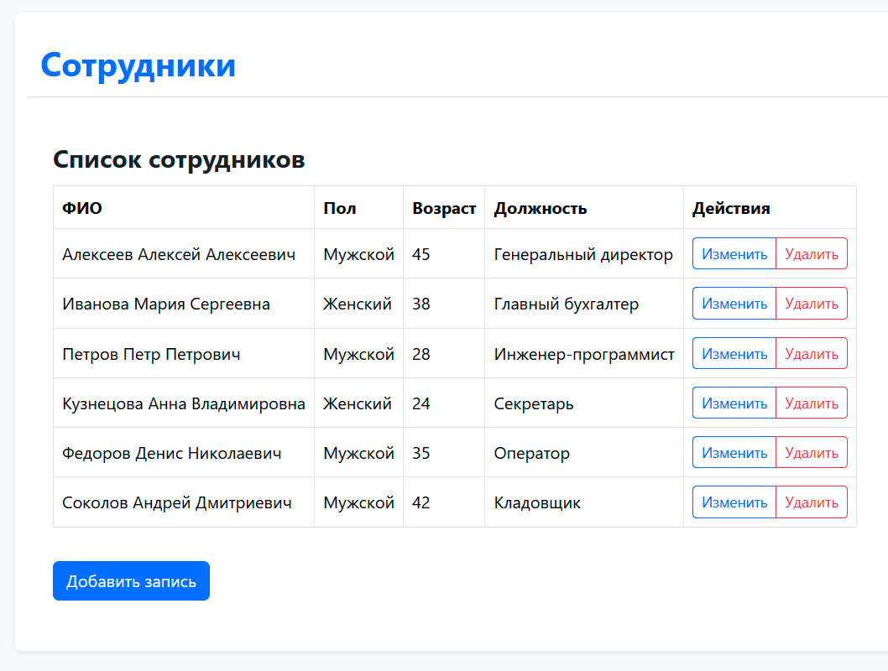
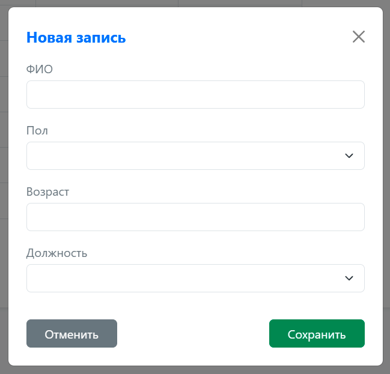
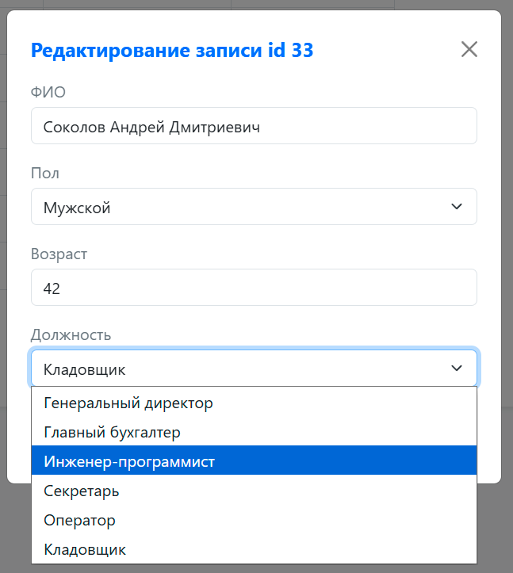
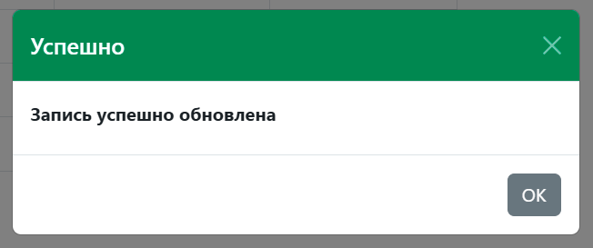
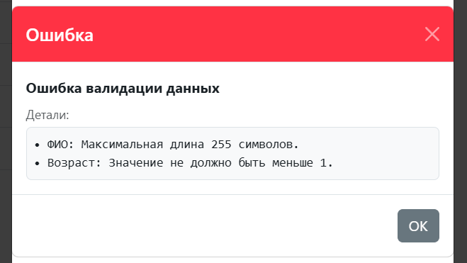
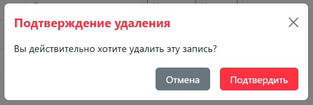
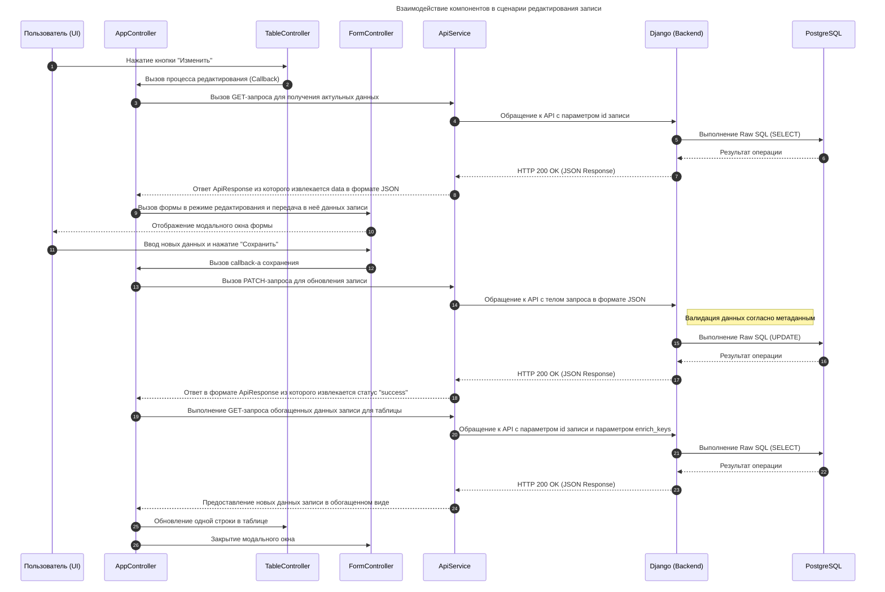

# Web-приложение Django по управлению электронной базой сотрудников
Разработчик проекта: Буньков Кирилл Андреевич.

## Стек используемых технологий
- Python 3.7
- Django 1.11
- JavaScript (типизация через JDocs и TypeScript) + Bootstrap 5
- PostgreSQL 11.1

## Функциональные возможности решения
Решение позволяет выполнять все базовые операции (создание, просмотр, редактирование и удаление записей) в отношении ключевых сущностей **"Сотрудники"** и **"Должности"**.

Работа с данными происходит через интуитивно понятный графический интерфейс на базе модальных окон **Bootstrap**. Клиент и сервер взаимодействуют асинхронно в формате JSON, что позволяет получать данные без перезагрузки страницы.

## Демонстрация работы
Интерфейс разделов **"Сотрудники"** и **"Должности"** стандартизирован: оба раздела используют идентичную механику работы таблиц и модальных окон. Процесс работы продемонстрирован ниже на примере раздела **"Сотрудники"**.

### Просмотр и управление записями
Интерфейс содержит интерактивную таблицу со списком сотрудников, кнопками редактирования/удаления и возможностью добавления новых записей.



### Создание записей
При нажатии кнопки **"Добавить"** появляется модальное окно формы ввода данных.



### Редактирование записей
При нажатии кнопки **"Изменить"** появляется то же самое окно, но уже в режиме редактирования.

В форме отображаются актуальные данные из таблицы **"Должности"** в виде выпадающего списка.



### Информационное уведомление
После завершения операции появляется всплывающее сообщение, подтверждающее сохранение изменений в базе данных.



### Уведомление об ошибках
Механизм валидации проверяет пользовательский ввод, в случае наличия ошибок пользователь получит уведомление.



### Удаление записи
При удалении записи система запрашивает подтверждение пользователя.




## Используемые архитектурные решения
### Общая концепция
Для обеспечения согласованной работы бэкенда и фронтенда выбран подход проектирования на основе метаданных. Метаданные описывают схему таблиц и столбцов таблиц, определяют ограничения ввода данных и прочую информацию. Метаданные хранятся в коде бэкенда и позволяют в одном месте осуществить необходимую настройку работы всего решения. Метаданные вшиваются в шаблон страницы Django и используются кодом JS.

Интерфейс метаданных типизирован и вынесен в отдельные файлы:
- в Python - файл view_meta.py;
- в JS - файл api.d.ts.

В решении реализована многоуровневая валиданция данных поступающих от клиента:
- проверка вводимых данных на стороне клиента;
- проверка входящего запроса со стороны бэкенда Django;
- проверка на стороне СУБД PostgreSQL.

Возникающие ошибки возвращаются в виде сообщения в интерфейс клиента.

### База данных (PostgreSQL)
На стороне СУБД реализованы таблицы должностей и сотрудников.
Валидность данных контролируется через:
- Ограничения NOT NULL и UNIQUE гарантирует отсутствие пустых записей и дубликатов.
- Ограничение `CHECK` обеспечивает корректность вводимых значений в пределах заданного диапазона.
- Перечисляемый типы данных `ENUM` ограничивает варианты выбора.

Представление данных формируется на стороне бэкенда с помощью `Raw SQL` запросов.

### Серверная логика (Бэкенд)
Решение спроектировано в виде отдельного модуля (приложения) `STAFFAPP`.

API реализован на базе встроенного в Django класса View, предоставляющего готовые методы диспетчеризации клиентских запросов (`GET`, `POST`, `PATCH`, `DELETE`).

Реализован механизм обогащения данных внешних ключей (`foreight keys`) для интерфейса клиента (управляется параметром `enrich_keys`). Обогащение позволяет вернуть вложенные объекты вместо неинформативных ключей.

Реализована валидация данных, которые присылает клиент, на основе схемы метаданных конкретной таблицы.

Все ответы бэкенд возвращает в формате **JSON**, который строго соответствует интерфейсу `ApiResponse` на клиентской стороне.

<details>
<summary><b>Структура ответа бэкенда</b></summary>

```json
{
  "status": "success | error",  // Статус операции (успех или ошибка)
  "message": "текст",           // Краткое описание результата
  "data": {},                   // [Опционально] Данные ответа
  "error_details": "текст"      // [Опционально] Детали ошибки
}
```
</details>

<details>
<summary><b>Пример: Ответ об успехе (HTTP 201 Created)</b></summary>

```json
{
  "status": "success",
  "message": "Запись успешно сохранена",
  "data": {
    "id": 42
  }
}
```
</details>

<details>
<summary><b>Пример: Ответ с ошибками валидации (HTTP 400 Bad Request)</b></summary>

```json
{
  "status": "error",
  "message": "Ошибка валидации данных",
  "error_details": "• Возраст: Значение должно быть больше нуля.\n• ФИО: Максимальная длина 255 символов."
}
```
</details>

Бэкенд возвращает стандартные коды ответа:
- 200 OK: Запись успешно удалена или обновлена.
- 201 Created: Запись успешно сохранена.
- 400 Bad Request: Не передан id или ошибка валидации данных.
- 404 Not Found: Запись с указанным id не найдена.
- 500 Internal Server Error: Непредвиденная ошибка сервера.

### Интерфейс пользователя (Фронтенд)
Пользовательский интерфейс спроектирован в объектно-ориентированном стиле. Это позволяет...
Для борьбы со сложностью и соблюдения принципа DRY (Don't Repeat Yourself) в рамках тестового задания создан свой микро-фреймворк состоящий из набора классов-контроллеров управляющих пользовательским интерфейсом.
Зона ответственности контроллеров разделена следующим образом:
- AppController отвечает за построение каркаса всего интерфейса, координирует сетевой обмен данными в формате JSON через ApiService, а также координирует работу остальных контроллеров интерфейса через механизм обратного вызова (коллбэков).
- TableController отвечает за отображение данных в виде таблицы, содержит элементы управления (кнопки) вызывающие форму редактирования или запрос на удаление записи.
- FormController отвечает за отображение данных в виде формы ввода. Осуществляет обратные вызовы к AppController для передачи запроса бэкенду.
- Дополнительные контроллеры: InfoController управляет окном с выводом информационных сообщений, а ConfirmController запрашивает у пользователя подтверждение необратимых операций.

Контроллеры в своей работе используют модальные окна фреймворка Bootstrap.

<b>Диаграмма взаимодействия компонентов на примере сценария редактирования записи</b>



## Развертывание проекта
### Общие рекомендации по запуску
Для выполнения требований независимости от сторонних сервисов в проекта добавлены компоненты Bootstrap 5 ("bootstrap.bundle.min.js", "bootstrap.min.css").
В случае разворачивания проекта на сервере с ОС Astra Linux можно перейти на использование встроенного в систему пакета Bootstrap 5 (libjs-bootstrap5).
### Особенности развертывания в Astra Linux
