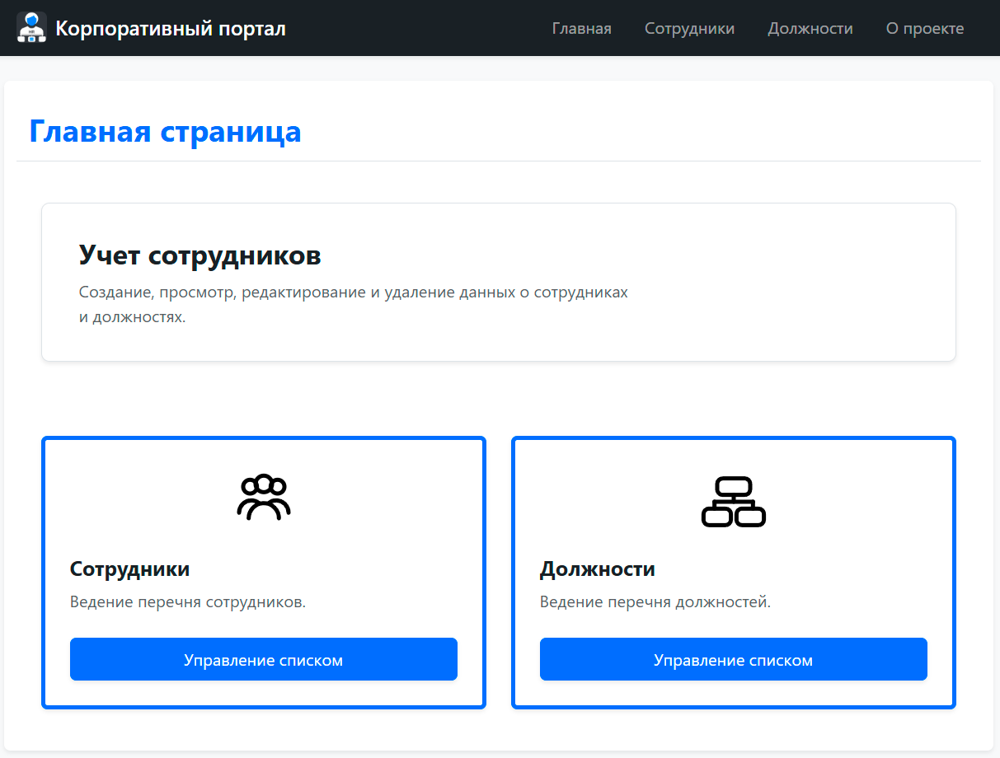
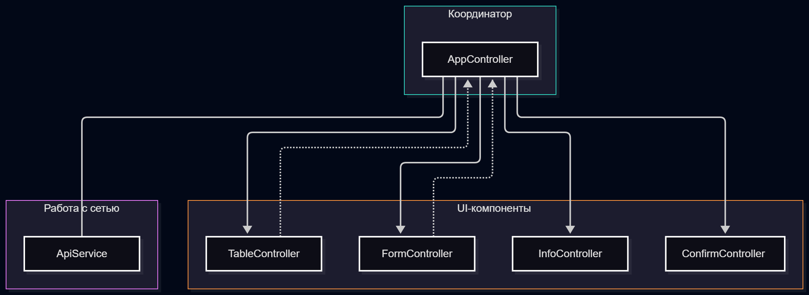
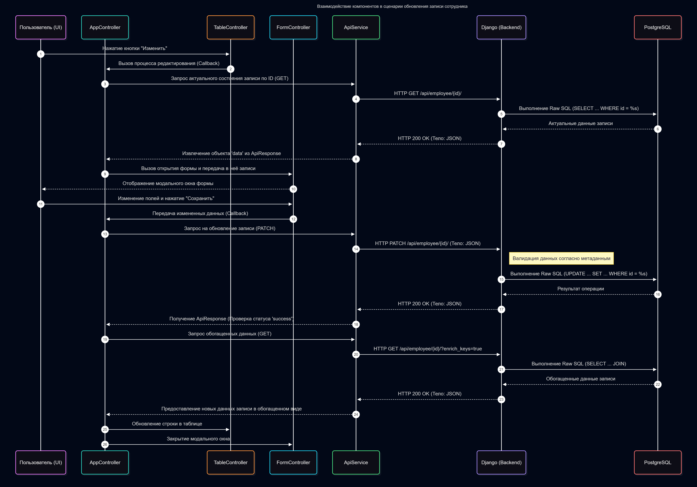

# DJANGO-STAFF
Проект размещен: https://github.com/Reideaz/django-staff

Web-приложение на Django для ведения списка сотрудников и должностей. Тестовое задание на позицию инженер-программист.

## Стек используемых технологий
- Python 3.7
- Django 1.11
- JavaScript + Bootstrap 5
- PostgreSQL 11.1

## Функциональные возможности
Приложение позволяет создавать, просматривать, редактировать и удалять данные о сотрудниках и должностях.

Работа с данными происходит через интуитивно понятный графический интерфейс на базе модальных окон **Bootstrap**. Клиент и сервер взаимодействуют асинхронно в формате JSON, что позволяет получать данные без перезагрузки страницы.

## Демонстрация работы

### Главная страница
Стартовая страница приложения обеспечивает быстрый доступ к основным разделам системы **"Сотрудники"** и **"Должности"**.



Интерфейс разделов **"Сотрудники"** и **"Должности"** стандартизирован: оба раздела используют идентичную механику работы таблиц и модальных окон. Процесс работы продемонстрирован ниже на примере раздела **"Сотрудники"**.

### Просмотр и управление записями
Интерфейс содержит таблицу со списком сотрудников, кнопками редактирования, удаления и возможностью добавления новых записей.


При нажатии кнопки **"Добавить запись"** появляется модальное окно формы ввода данных.


При нажатии кнопки **"Изменить"** появляется то же самое окно, но уже в режиме редактирования.

В форме отображаются актуальные данные из таблицы **"Должности"** в виде выпадающего списка.


После завершения редактирования и нажатии кнопки **"Сохранить"** появляется всплывающее сообщение, подтверждающее сохранение изменений в базе данных.


Механизм валидации проверяет пользовательский ввод, в случае наличия ошибок пользователь увидит сообщение.


При удалении записи система запрашивает подтверждение.


## Общая концепция архитектуры
Проект разработан на базе фреймворка Django с применением объектно-ориентированных принципов проектирования классов. Для повышения надёжности и безопасности процесса разработки используются статические анализаторы кода и применяются аннотации типов: Type Hinting в Python, JSDoc в JavaScript (и TypeScript), что позволяет выявлять логические ошибки и несоответствия передаваемых типов на этапе написания кода в IDE.

Для обеспечения согласованной работы бэкенда и фронтенда выбран подход проектирования на основе метаданных. Метаданные выступают единым источником истины: описывают схемы таблиц, задают ограничения для ввода данных и позволяются централизованно осуществлять настройку всего приложения из одного места в коде бэкенда.

В рамках этой архитектуры интерфейс метаданных также является строго типизированным и вынесен в отдельные файлы: [`view_meta.py`](./staffapp/view_meta.py) (в Python), [`api.d.ts`](./static/js/api.d.ts) (в JS).

Сформированные на бэкенде метаданные вшиваются в шаблоны страниц Django и используются клиентской частью для построения интерфейса и логики.

В проекте реализована многоуровневая валидация данных поступающих от клиента:
- проверка вводимых данных на стороне клиента;
- валидация входящего запроса в бэкенде Django;
- проверка со стороны СУБД PostgreSQL.

## База данных (PostgreSQL)
На стороне СУБД реализованы таблицы должностей и сотрудников.
Валидность данных контролируется с помощью следующих механизмов:
- Ограничения NOT NULL и UNIQUE гарантирует отсутствие пустых записей и дубликатов.
- Ограничение `CHECK` обеспечивает корректность вводимых значений в пределах заданного диапазона.
- Перечисляемый типы данных `ENUM` ограничивают варианты выбора.

Представление данных формируется на стороне бэкенда с помощью `Raw SQL-запросов`.

## Серверная логика (Бэкенд)
Архитектурно серверная часть разделена на базовый модуль `main` (конфигурация проекта) и основное Django-приложение `staffapp` (API для работы с сотрудниками и должностями).

Для построения API создан базовый класс [`BaseAPIView`](./staffapp/base_api_view.py) на основе стандартного `django.views.View` в котором переопределён метод распределения клиентских запросов `dispatch()`. Метод перехватывает исключения (ошибки парсинга, валидации и непредвиденные сбои сервера) и избавляет дочерние классы [`PositionAPIView`](./staffapp/position_api_view.py), [`EmployeeAPIView`](./staffapp/employee_api_view.py) от дублирования блоков `try-except`.

По мере развития проекта типовые операции с таблицами были вынесены в универсальные функции (`get_from_table`, `patch_in_table`, `delete_from_table`). В то же время, метод создания записей и сложные выборки со связями (`JOIN`) реализованы через явные параметризованные SQL-запросы, что сохраняет наглядность кода и упрощает его тестирование и отладку.

В частности, с использованием `JOIN` реализован механизм обогащения внешних ключей для интерфейса клиента. При передаче в метод GET параметра `enrich_keys=true` бэкенд заменяет простые внешние ключи вложенными объектами.

Пример SQL-запроса:

```sql
SELECT json_agg(row_to_json(row))::text 
FROM (
    SELECT 
        e.id, 
        e.full_name, 
        e.gender, 
        e.age,
        json_build_object('value', e.position_id::text, 'label', p.title) AS position_id,
        p.category
    FROM employees e
    LEFT JOIN positions p ON e.position_id = p.id
    ORDER BY e.id
) row;
```

Функция `json_build_object` превращает внешний ключ `position_id` в объект формата `{"value": "1", "label": "Инженер-программист"}` (приведение к `::text` внутри гарантирует строковый формат id для фронтенда). Благодаря использованию `row_to_json` и `json_agg` PostgreSQL собирает всю выборку в единую JSON-строку, избавляя Python от необходимости перебирать строки ответа в цикле и вручную формировать словари. Явное приведение результата к `::text` заставляет драйвер БД вернуть сырую строку без промежуточного парсинга в объекты Python, что исключает лишнюю сериализацию перед отправкой готового HTTP-ответа.

### Спецификация API эндпоинтов

Маршрутизация запросов на стороне Django осуществляется с помощью регулярных выражений расположенных в файле [urls.py](./staffapp/urls.py). Идентификатор записи (`id`) передается как параметр пути URL.

Реализованы следующие API эндпоинты:

**1. Эндпоинты для работы со списком сотрудников**
*   **`GET /api/employee/`** — Извлечение списка всех сотрудников.
    *   *Опциональный параметр*: `enrich_keys=true`.
*   **`GET /api/employee/<id>/`** — Получение актуальных данных конкретного сотрудника.
    *   *Опциональный параметр*: `enrich_keys=true`.
*   **`POST /api/employee/`** — Добавление нового сотрудника в базу данных. Уникальный идентификатор `id` генерируется на стороне PostgreSQL и возвращается интерфейсу клиента.
    *   *Тело запроса*: JSON-объект со всеми обязательными полями.
*   **`PATCH /api/employee/<id>/`** — Обновление данных сотрудника.
    *   *Тело запроса*: JSON-объект с обновляемыми полями: ФИО, пол, возраст, должность.
*   **`DELETE /api/employee/<id>/`** — Удаление сотрудника.

**2. Эндпоинты для работы со списком должностей**
*   **`GET /api/position/`** — Получение списка всех должностей.
*   **`GET /api/position/<id>/`** — Получение актуальных данных одной должности.
*   **`POST /api/position/`** — Добавление новой должности.
    *   *Тело запроса*: JSON-объект со всеми обязательными полями.
*   **`PATCH /api/position/<id>/`** — Обновление данных должности.
    *   *Тело запроса*: JSON-объект с обновляемыми полями: название, категория.
*   **`DELETE /api/position/<id>/`** — Удаление должности.

### Формат ответа бэкенда

**Бэкенд возвращает предсказуемые коды HTTP-ответов**
- 200 OK: Запись успешно удалена или обновлена.
- 201 Created: Запись успешно создана.
- 400 Bad Request: Ошибка валидации данных.
- 404 Not Found: Запись с указанным id не найдена.
- 500 Internal Server Error: Непредвиденная ошибка сервера.

Бэкенд формирует HTTP-ответ с телом в формате **JSON**, структура которого соответствует интерфейсу [`ApiResponse`](./static/js/api.d.ts) на клиентской стороне.

**Структура ответа бэкенда**

```json
{
  "status": "success | error",  // Статус операции (успех или ошибка)
  "message": "текст",           // Краткое описание результата
  "data": {},                   // [Опционально] Данные ответа
  "error_details": "текст"      // [Опционально] Детали ошибки
}
```

**Пример ответа об успехе (HTTP 201 Created)**

```json
{
  "status": "success",
  "message": "Запись успешно сохранена",
  "data": {
    "id": 42
  }
}
```

**Пример ответа с ошибками валидации (HTTP 400 Bad Request)**

```json
{
  "status": "error",
  "message": "Ошибка валидации данных",
  "error_details": "• Возраст: Значение должно быть больше нуля.\n• ФИО: Максимальная длина 255 символов."
}
```

## Интерфейс пользователя (Фронтенд)
Интерфейс спроектирован в объектно-ориентированном стиле.
Чтобы не дублировать код и снизить его сложность, в проекте реализован собственный микрофреймворк. Он представляет собой набор классов-контроллеров, отвечающих за логику пользовательского интерфейса.

**Схема взаимодействия компонентов**



Зоны ответственности контроллеров разделены следующим образом:

- [`AppController`](./static/js/app-controller.js) выступает в качестве главного контроллера: управляет сетевым обменом в формате JSON через [`ApiService`](./static/js/api-service.js) и связывает компоненты через передачу функций обратного вызова (Callback), с помощью которых они делегируют обработку событий главному контроллеру.

- [`TableController`](./static/js/table-controller.js) отвечает за отображение данных в виде таблицы и содержит элементы управления (кнопки), запускающие события редактирования и удаления конкретной записи.

- [`FormController`](./static/js/form-controller.js) управляет окном формы ввода, осуществляет первичную валидацию. Вызывает событие сохранения данных и запрашивает загрузку связанных списков.

- [`InfoController`](./static/js/info-controller.js) управляет окном вывода информационных сообщений.

- [`ConfirmController`](./static/js/confirm-controller.js) запрашивает у пользователя подтверждение операций.

Контроллеры в своей работе используют модальные окна фреймворка Bootstrap.

**Диаграмма последовательности на примере сценария обновления записи о сотруднике**



## Развертывание проекта

В состав проекта включены готовые SQL-скрипты для создания и настройки базы данных. Описание не включает в себя процесс установки самой СУБД в систему. Проект успешно работает с СУБД PostgreSQL версии 11.21 и с версией 15.19.

### 1. Подготовка СУБД PostgreSQL

#### Предварительная подготовка

Подключитесь к СУБД под учетной записью суперпользователя `postgres` и выполните команды создания пользователя и базы данных:

```sql
-- Команда создания пользователя
CREATE USER admin WITH PASSWORD '1234';

-- Команда создания тестовой базы
CREATE DATABASE staff OWNER admin;
```

#### Создание и наполнение таблиц через скрипт

От имени пользователя `postgres` переключитесь на созданную тестовую базу `staff` (выполнив команду `\c staff` в `psql` или открыв `Query Tool` для этой базы в `pgAdmin`) и выполните скрипт [`bd-staff-commands.sql`](./bd-staff-commands.sql). Обратите внимание, что перед созданием таблиц скрипт передает все права на схему public пользователю admin, от имени которого затем и создаются сами таблицы.

### 2. Настройка системного окружения

Для работы проекта в окружении должны присутствовать интерпретатор Python 3.7, фреймворк Django 1.11 и драйвер Psycopg2.

В среде AstraLinux 1.7 их установка осуществляется командами:

```shell
sudo apt install python3
sudo apt install python3-django
sudo apt install python3-psycopg2
```

В случае развертывания проекта в другой ОС рекомендуется использовать виртуальное окружение. Подробнее в файле [`venv_create.txt`](./venv_create.txt).

### 3. Запуск приложения

Для упрощения демонстрации в проекте отключена аутентификация, поэтому создавать учетные записи и выполнять первичные миграции Django не нужно.

Запустите встроенный сервер разработки:

```shell
# Стандартная команда
python manage.py runserver

# Для Astra Linux 1.7
python3 manage.py runserver
```

Приложение будет доступно по адресу `http://127.0.0.1:8000/`.

### Особенности развертывания в продакшене на Astra Linux
Для выполнения требования независимости от сторонних сервисов в проект были добавлены файлы Bootstrap 5 ("bootstrap.bundle.min.js", "bootstrap.min.css"). В случае разворачивания проекта на сервере с ОС Astra Linux можно перейти на использование встроенного в систему пакета Bootstrap 5 (libjs-bootstrap5) и избавиться от сторонних файлов.

## Разработчик проекта 
**Буньков Кирилл**